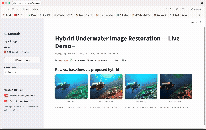

# Hybrid Adaptive Color Correction, CLAHE, and Dehazing Framework for Underwater Image Restoration and Quality Enhancement


VIT — School of Computer Science and Engineering | Project for BCSE403L Digital Image Processing | Fall 2026-2027
Team: Kopal Sachan (23BCE0238), Yathaartha Srivastava (23BCE0543), Manav Prakash (23BCE0548)



*Live demo of the [Streamlit frontend](#9-interactive-demo-streamlit) — comparison, pipeline stages, metrics, and live ablation toggles.*

---

## 1. Pipeline Overview

```
Input image
   │
   ▼
[Module 5] Water-Type Classifier  ─────────────────────────────────►  ★ NOVEL
   │  (routes per-stage parameters by water type: clear_blue /
   │   green_turbid / deep_lowlight / hazy_bright)
   ▼
[Module 1] Adaptive White Balance  (Gray-World / von Kries gains)
   ▼
[Module 2] Adaptive Gamma Correction  (luminance-histogram driven)
   ▼
   ├──────────────► [Module 3] CLAHE in CIELAB  ─────┐
   │                                                   │
   └──────────────► [Module 4] UDCP Dehazing +        │
                     Guided-Filter Refinement          │
                                                        ▼
                          [Module 7] Fusion-Weight Optimizer ──► ★ NOVEL
                          (golden-section search maximizing
                           UCIQE+UIQM of the fused output)
                                                        │
                                                        ▼
                          [Module 6] Multi-scale Laplacian
                                     Pyramid Fusion
                                                        │
                                                        ▼
                                              Restored image
                                                        │
                                                        ▼
                          [Module 8] Quantitative Evaluation
                          (PSNR, SSIM, entropy, UCIQE, UIQM)
                                                        │
                                                        ▼
                          [Module 9] Downstream Task Validation ──► ★ NOVEL
                          (ORB keypoint yield/matching, edge density)
```

## 2. Novel Contributions (beyond the baseline Review-I proposal)

| # | Contribution | File | What it adds over existing literature |
|---|---|---|---|
| 1 | **Water-Type-Aware Parameter Routing** | `modules/water_type_classifier.py` | Classifies each image into one of 4 water-type clusters using cheap colour/haze statistics, then routes *how strongly* each stage's adaptive rule acts. Existing hybrid pipelines use one global adaptive formula for every image. |
| 2 | **Quality-Metric-Guided Fusion Weights** | `modules/fusion_optimizer.py` | Per-image golden-section search over the fusion blend weight (α), directly maximizing the image's own UCIQE+UIQM score. No training data needed — self-referential optimization. Existing fusion methods use fixed or heuristic saliency-only weights. |
| 3 | **Downstream Task Validation** | `modules/downstream_validation.py` | Benchmarks restoration using ORB keypoint yield/matchability and Canny edge density — proxies for whether restoration actually helps AUV/SLAM/detection pipelines, not just whether the image "looks better" by colorimetric metrics. |

## 3. Project Structure

```
underwater_restoration/
├── modules/
│   ├── white_balance.py          # Module 1
│   ├── gamma_correction.py       # Module 2
│   ├── clahe_module.py           # Module 3
│   ├── dehazing.py               # Module 4
│   ├── water_type_classifier.py  # Module 5  ★ NOVEL
│   ├── fusion.py                 # Module 6
│   ├── fusion_optimizer.py       # Module 7  ★ NOVEL
│   ├── metrics.py                # Module 8
│   ├── downstream_validation.py  # Module 9  ★ NOVEL
│   └── dataset_loader.py         # resolves UIEB raw/reference/challenging
│                                  # paths (local data/ or external SSD)
├── pipeline.py                   # orchestrates all modules + baselines
├── main.py                       # CLI demo entry point (single image)
├── batch_evaluate.py             # runs the pipeline over all 890 UIEB pairs,
│                                  # accumulates metrics to CSV; --no-routing /
│                                  # --fixed-alpha drive the ablation configs
├── investigate_fusion_alpha.py   # Module 7 diagnostic: fine alpha-grid scan
│                                  # + curve-shape classification per image
├── build_report_data.py          # batch CSVs -> summary/significance/
│                                  # per-water-type/ablation analysis tables
├── build_results_docx.py         # analysis tables -> Review II results .docx
├── streamlit_app.py              # interactive demo frontend (see Section 9)
├── data/
│   ├── raw/                      # put UIEB raw-890/ images here
│   ├── reference/                # put UIEB reference-890/ images here
│   └── challenging/               # put UIEB challenging-60/ images here
├── outputs/                      # restored images, batch CSVs, analysis
│                                  # tables, generated docx, diagnostic plots
└── requirements.txt
```

## 4. Setup

```bash
pip install -r requirements.txt
```

The project venv (`dip/`) is checked in locally at the project root for this
machine; on a fresh clone, create your own instead (`python3 -m venv dip &&
./dip/bin/pip install -r requirements.txt`) and use `./dip/bin/python3` /
`./dip/bin/streamlit` in the commands below.

## 5. Getting the Dataset (UIEB)

Download via Kaggle mirrors and place into `data/`:

```python
import kagglehub
raw_path = kagglehub.dataset_download("larjeck/uieb-dataset-raw")
ref_path = kagglehub.dataset_download("larjeck/uieb-dataset-reference")
```

Or download manually from the official page: https://li-chongyi.github.io/proj_benchmark.html

Expected layout after download:
```
data/raw/*.png            # 890 raw underwater images
data/reference/*.png      # 890 paired reference images (same filenames)
data/challenging/*.png    # 60 no-reference challenging images
```

**Loading from an external drive instead of `data/`:** `modules/dataset_loader.py`
resolves each split's directory by checking, in order: an env var override
(`UIEB_RAW_DIR` / `UIEB_REFERENCE_DIR` / `UIEB_CHALLENGING_DIR`) → the local
`data/*` folders above → an external SSD mount (defaults to
`/Volumes/Lexar/raw-890`, `/Volumes/Lexar/reference-890`,
`/Volumes/Lexar/challenging-60`). Run `python modules/dataset_loader.py` to
sanity-check which paths resolve, or use it programmatically:

```python
from modules.dataset_loader import list_pairs, iter_pairs, load_pair

pairs = list_pairs()                       # [(filename, raw_path, reference_path), ...]
raw_img, ref_img = load_pair("10139.png")   # BGR np.ndarrays

for name, raw_img, ref_img in iter_pairs(): # lazy iteration over all 890 pairs
    ...
```

## 6. Usage

**Smoke test (no dataset needed — uses a synthetic underwater-like image):**
```bash
python main.py --compare-baselines --downstream-eval
```

**Run on a real UIEB image with full evaluation:**
```bash
python main.py \
  --input data/raw/example.png \
  --reference data/reference/example.png \
  --output outputs/restored_example.png \
  --compare-baselines \
  --downstream-eval
```

**Ablation runs on a single image:**
```bash
# Disable water-type routing — falls back to single global adaptive formula
python main.py --input data/raw/example.png --no-routing

# Disable fusion optimizer — uses fixed alpha=0.5
python main.py --input data/raw/example.png --no-fusion-opt
```

**Batch-evaluate all 890 UIEB pairs** (writes one CSV row per image; see
`modules/dataset_loader.py` for where images are read from):
```bash
python batch_evaluate.py --output outputs/batch_metrics.csv               # full hybrid (routing + fusion-optimizer)
python batch_evaluate.py --no-routing --output outputs/ablation_no_routing.csv       # fusion-optimizer only
python batch_evaluate.py --fixed-alpha 0.5 --output outputs/ablation_fixed_alpha.csv # routing only
python batch_evaluate.py --no-routing --fixed-alpha 0.5 --output outputs/ablation_neither.csv  # neither novel module (control)
```
Add `--limit N` for a quick test run, `--no-downstream` to skip the slower
ORB/edge-density metrics. Each full run takes on the order of 30-50 minutes
(dominated by ORB keypoint detection at a high cap — see Section 8).

**Turn the four CSVs above into report-ready tables and a results-section docx:**
```bash
python build_report_data.py   # -> outputs/summary_stats.csv, significance_tests.csv,
                               #    per_watertype_breakdown.csv, ablation_summary.csv,
                               #    ablation_module_deltas.csv
python build_results_docx.py  # -> outputs/Review_II_Results_Section.docx
```

**Investigate whether Module 7's golden-section search is valid** (fine
alpha-grid scan + curve-shape classification on sample images spanning all
four water types):
```bash
python investigate_fusion_alpha.py   # -> outputs/fusion_alpha_investigation/*.png
```

## 7. Ablation / Evaluation Table

`build_report_data.py` generates this directly from the four batch CSVs
(`outputs/ablation_summary.csv`, with module contributions isolated by
subtraction in `outputs/ablation_module_deltas.csv`), and `build_results_docx.py`
formats it into `outputs/Review_II_Results_Section.docx` alongside significance
tests, the per-water-type routing breakdown, and downstream validation results:

| Configuration | PSNR ↑ | SSIM ↑ | Entropy ↑ | UCIQE ↑ | UIQM ↑ |
|---|---|---|---|---|---|
| Conventional (global HE) baseline | | | | | |
| CLAHE-only baseline | | | | | |
| Hybrid — no routing, fixed α=0.5 (neither novel module) | | | | | |
| Hybrid — no routing, optimized α (fusion-optimizer only) | | | | | |
| Hybrid — routing, fixed α=0.5 (routing only) | | | | | |
| **Hybrid — full (routing + fusion-optimizer)** | | | | | |

`row(full) - row(neither)` = combined novel-module gain; `row(fusion-optimizer
only) - row(neither)` and `row(routing only) - row(neither)` isolate each
module individually. Downstream validation (`keypoint_gain_pct`,
`edge_density_gain_pct`, `cross_matches`) is reported the same way, as a
separate table in the generated docx.

## 8. Known Issues Found & Fixed

Two real bugs surfaced while building out the batch evaluation, both silent
(no crash, just wrong numbers) — worth recording since they'd otherwise
quietly poison the report's evaluation tables:

- **UCIQE blow-up on near-black pixels** (`modules/metrics.py`,
  `compute_uciqe`). Average saturation was computed as `chroma / (L + 1e-6)`;
  a handful of pixels with `L ≈ 0` (borders/shadows/vignetting, common in
  UIEB raw images) sent individual pixels' saturation into the millions,
  which then dominated the whole-image mean. Fixed by excluding pixels with
  `L < 1.0` from the saturation mean rather than merely epsilon-guarding the
  division. Affected the majority of images before the fix (e.g. 59% of
  `hybrid_uciqe` values were > 1000, vs. a sane 0-100 range after).
- **ORB keypoint cap artificially tying raw vs. restored counts**
  (`modules/downstream_validation.py`). `cv2.ORB_create(nfeatures=1000)` was
  low enough that both raw and restored images routinely hit the same
  ceiling, reporting `keypoint_gain_pct == 0%` for a large fraction of the
  dataset even though restoration was clearly revealing more real detail.
  Raised to `nfeatures=200000`, a figure derived by sampling actual keypoint
  counts across the dataset (restored images were found reaching up to
  ~144k). Also fixed `_pct_change` returning `inf` when a raw image had zero
  detected keypoints — it now returns `None` (excluded from aggregates)
  instead.

## 9. Interactive Demo (Streamlit)

```bash
streamlit run streamlit_app.py
# or, using the project venv directly:
./dip/bin/streamlit run streamlit_app.py
```

Opens at `http://localhost:8501`. Lets you pick any UIEB image (or upload
your own) and toggle **Water-Type Routing** (Module 5) and the **Fusion
Optimizer** (Module 7) on/off live, for demoing the ablation in real time
rather than only showing a static table:

- **Comparison** — raw vs. conventional HE vs. CLAHE-only vs. proposed hybrid, side by side
- **Pipeline Stages** — every intermediate stage (white balance → gamma → CLAHE/DCP streams → fusion), plus Module 7's golden-section search convergence, scrubbable iteration by iteration
- **Metrics** — entropy/UCIQE/UIQM bars for the current image; live PSNR/SSIM once a reference image is available (auto-paired for UIEB dataset picks)
- **Downstream Validation** — ORB keypoints + edge density, run on demand (slower, see Section 8)
- **About** — pipeline diagram + team info

## 10. Next Steps

1. ~~Download UIEB into `data/`~~ — done, loaded from an external SSD via `modules/dataset_loader.py` instead of copying locally.
2. ~~Write a batch-evaluation script~~ — done (`batch_evaluate.py` + `build_report_data.py` + `build_results_docx.py`).
3. Tune `TYPE_PROFILES` thresholds in `water_type_classifier.py` against real UIEB water-type diversity (currently hand-set; could be refined by inspecting cluster statistics across the dataset — `outputs/per_watertype_breakdown.csv` is a start).
4. Review `outputs/Review_II_Results_Section.docx` once all four batch configs finish, and fold it into the full Review II report structure.
5. Investigate the non-convex fusion-optimizer case(s) flagged by `investigate_fusion_alpha.py` further — golden-section search can land on a local optimum on a minority of images (see the script's output for specifics); a safeguard (e.g. bracketing grid search as a fallback) is a possible follow-up.
