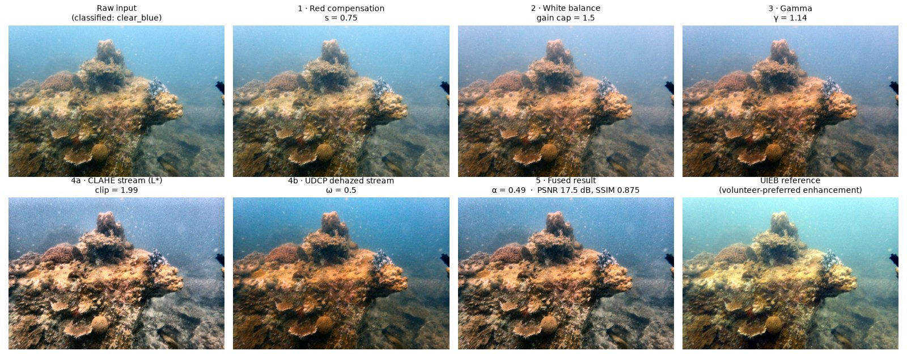

# Hybrid Adaptive Color Correction, CLAHE, and Dehazing Framework for Underwater Image Restoration and Quality Enhancement


VIT — School of Computer Science and Engineering | Project for BCSE403L Digital Image Processing | Fall 2026-2027
Team: Kopal Sachan (23BCE0238), Yathaartha Srivastava (23BCE0543), Manav Prakash (23BCE0548)

A classical (no deep learning) pipeline that restores underwater photographs.
It combines red-channel compensation, white balance, gamma correction, CLAHE
and underwater dark-channel dehazing, then fuses a detail stream with a
dehazed stream. Every stage is adapted to the type of water detected in the
image, and every parameter was calibrated on one part of the UIEB dataset
and evaluated on a separate, held-out part.

**Documentation:** [docs/](docs/) has a [code guide](docs/CODE_GUIDE.md), a
[presentation guide](docs/PRESENTATION_GUIDE.md) and the
[review deck](docs/Review_II_Presentation.pptx).

**Results at a glance** (622 held-out UIEB test images; full tables in [Section 7](#7-evaluation-results)):

| Method | PSNR (dB) ↑ | SSIM ↑ |
|---|---|---|
| UDCP (physics-based dehazing) | 12.99 | 0.656 |
| Conventional histogram equalisation | 16.36 | 0.781 |
| CLAHE-only | **18.32** | 0.840 |
| Gray-world WB + CLAHE (common practitioner recipe) | 17.93 | 0.838 |
| **Proposed hybrid** | **18.27** | **0.871** |

The proposed hybrid has the highest SSIM of all methods, matches CLAHE-only on
PSNR (−0.04 dB: negligible and not significant), and clearly beats the usual
practitioner recipe of gray-world white balance + CLAHE (+0.34 dB, +0.033 SSIM),
HE (+1.91 dB) and UDCP (+5.29 dB). See [Section 1.6](#16-what-each-part-contributes).


*Demo of an earlier version of the [Streamlit frontend](#9-interactive-demo-streamlit). The current UI is described in Section 9.*

---

## 1. How the proposed hybrid works

### 1.1 The problem it solves

Underwater photos degrade in three physical ways, and each stage of the
pipeline targets one of them:

| Degradation | Cause | Visible effect | Handled by |
|---|---|---|---|
| **Colour cast** | Water absorbs red light first, then green; blue travels furthest | Blue-green tint, missing reds | Steps 1–2 (red compensation, white balance) |
| **Haze / veiling light** | Particles scatter light toward the camera | Washed-out, low-contrast, foggy distance | Step 4b (dehazing) |
| **Low light and flat contrast** | Light fades with depth; scattering flattens the tones | Dark images, little local detail | Steps 3 and 4a (gamma, CLAHE) |

How strong each degradation is depends on the water: deep water loses the
most red, turbid green water scatters the most, and bright shallow water is
mostly hazy. That is why a single fixed setting is a compromise, and why the
pipeline first works out what kind of water it is looking at.

### 1.2 Pipeline at a glance

```
Raw image
   │
   ▼
Step 0 · Water-type routing (Module 5) ★ ── classifies the water, selects a parameter profile
   │                                          (red strength, WB cap, gamma, CLAHE, dehazing)
   ▼
Step 1 · Red-channel compensation (Module 1a) ── rebuilds the absorbed red channel from green
   ▼
Step 2 · Gray-world white balance (Module 1b) ── neutralises the remaining colour cast
   ▼
Step 3 · Adaptive gamma (Module 2) ── adjusts overall brightness
   │
   ├────────────────────────────┐
   ▼                            ▼
Step 4a · CLAHE on L* (Module 3)   Step 4b · Underwater dark-channel dehazing (Module 4)
   "detail stream"                  "haze-free stream"
   └──────────────┬─────────────┘
                  ▼
Step 5 · Per-image fusion weight α (Module 7) ★ ── predicts how much to trust each stream
                  ▼
Step 6 · Multi-scale Laplacian-pyramid fusion (Module 6) ── blends the streams per pixel
                  ▼
           Restored image ──► Module 8 (quality metrics) · Module 9 ★ (downstream validation)

★ = novel contribution of this project
```

All stages run on one example test image (`794_img_.png`, classified *clear blue*):



*Regenerate with `python scripts/make_method_figure.py` (any UIEB image via `--image`).*

### 1.3 Stage by stage

Each stage below gives **what** it does, **why** underwater images need it,
**how** it works (the exact operation in the code), its **parameters**, and
what it did to the example image above.

---

#### Step 0 · Water-type routing — Module 5 ★
**File:** [modules/water_type_classifier.py](modules/water_type_classifier.py)

**What.** Puts the image into one of four water types and returns that
type's *parameter profile*, which every later stage reads.

**Why.** The right correction strength depends on the water. Deep water needs
strong red recovery; turbid water needs strong dehazing. One global setting
compromises across all of them.

**How.** Four cheap statistics are computed from the raw image:
- mean luminance (grayscale mean, 0–1)
- mean saturation (HSV S channel, 0–1)
- haze density (mean of the underwater dark channel, 0–1; see Step 4b)
- green dominance (mean G − max(mean B, mean R), on the 0–255 scale)

The rules are checked in order:

| Rule | Water type |
|---|---|
| mean luminance < 0.30 | **deep_lowlight** |
| green dominance > 8 **and** haze density > 0.35 | **green_turbid** |
| haze density > 0.45 **and** mean saturation < 0.35 | **hazy_bright** |
| otherwise | **clear_blue** |

**Parameters.** Each type maps to a profile of five values:

- `red_comp_strength`: Step 1
- `wb_gain_cap`: Step 2
- `gamma_strength`: Step 3
- `clahe_clip_scale`: Step 4a
- `dcp_omega`: Step 4b

All five were calibrated on the calibration split (Section 1.4). The live values
are in [modules/calibrated_profiles.json](modules/calibrated_profiles.json):

| Profile | red strength *s* | WB gain cap | gamma × | CLAHE clip × | DCP ω | Used by |
|---|---|---|---|---|---|---|
| **Global** (routing off) | 0.75 | 1.5 | 1.05 | 0.6 | 0.5 | clear_blue, green_turbid, deep_lowlight (fell back) |
| **hazy_bright** | 0.75 | 1.5 | **1.2** | **1.0** | **0.6** | well-lit, hazy images |

A type keeps its own profile only if it beat the global profile on its
calibration images with statistical significance (one-sided paired Wilcoxon,
p < 0.05). Otherwise it falls back to the global profile, which happened for
every type except *hazy_bright* (+0.36 dB PSNR from its own profile on its 35
test images). Overall, routing adds only +0.02 dB: after equal tuning, one
good global profile does almost as well as four.

**Example.** Luminance 0.50, saturation 0.34, haze 0.39, green dominance 1.0
match no special rule, so the image is classified **clear_blue**.

---

#### Step 1 · Red-channel compensation — Module 1a
**File:** [modules/white_balance.py](modules/white_balance.py) (`compensate_red_channel`)

**What.** Rebuilds the red channel that the water absorbed, using the green
channel.

**Why.** Red is absorbed within the first few metres, so the red channel of
a deep image is nearly empty. Simply scaling it up (Step 2 alone) mostly
amplifies noise. Green is better preserved and correlates with the scene's
true red content.

**How** (Ancuti et al., 2018), with all values in [0, 1]:

```
R' = R + s · (mean(G) − mean(R)) · (1 − R) · G
```

- `(mean G − mean R)` measures how much red is missing overall.
- `· G` adds red where there is green signal to borrow from.
- `(1 − R)` leaves pixels that are already red almost untouched.
- `s` is the routed strength. *s* = 0 turns the step off.

**Parameters.** *s* = **0.75** for every image. The strength was searched per
water type (best values: 0.75 for clear blue and green turbid, 0.5 for deep
low-light, 0 for hazy bright), but no type beat the single global strength
significantly, so all fall back to it (Section 1.4).

**Effect on its own** (held-out test set): **+0.52 dB PSNR** [95% CI 0.41–0.63]
and **+0.024 SSIM** [0.020–0.029]. This is the largest single improvement in
the project.

---

#### Step 2 · Gray-world white balance — Module 1b
**File:** [modules/white_balance.py](modules/white_balance.py) (`adaptive_white_balance`)

**What.** Removes the remaining colour cast so that the average colour of the
scene becomes neutral grey.

**Why.** After red compensation the image usually still leans blue or green.
The *gray-world* assumption, that a typical scene averages to grey, gives a
simple and robust correction.

**How.**
1. For each channel, compute a robust mean that ignores the brightest 0.5%
   of pixels (specular highlights would bias it).
2. Compute per-channel *von Kries* gains, `gain_c = mean_gray / mean_c`,
   where `mean_gray` is the average of the three channel means.
3. Clamp each gain to `[1 / cap, cap]` and multiply the channel by it.

**Parameters.** Gain cap = **1.5** for every profile after calibration, so a
channel can be scaled by at most 1.5× either way. This keeps a near-empty
channel from being blown up into noise, and it is the mildest cap searched.

---

#### Step 3 · Adaptive gamma — Module 2
**File:** [modules/gamma_correction.py](modules/gamma_correction.py)

**What.** Adjusts overall brightness with a gamma curve.

**Why.** Underwater images are often dark. A gamma curve lifts mid-tones
while keeping black and white fixed.

**How.**
```
μ, σ = mean and std of the grayscale image (0–1)
γ₀   = log(0.5) / log(μ)                         # moves mean brightness toward mid-grey
cf   = 1 + 2 · (0.25 − min(σ, 0.25))             # low contrast → stronger correction
γ    = γ₀ · cf if μ < 0.5 else γ₀ / cf
γ    = clip(γ · gamma_strength, 0.4, 2.2)        # gamma_strength from the routed profile
out  = 255 · (in / 255) ^ γ                      # γ < 1 brightens, γ > 1 darkens
```

**Parameters.** `gamma_strength` = 1.05 (global) and 1.2 for hazy bright.

**Example.** γ = 1.14. This image is already fairly bright (mean ≈ 0.5), so
the curve darkens it slightly.

> **Fixed bug.** Earlier code applied `out = in^(1/γ)` while γ₀ was derived
> for `out = in^γ`, so the adaptive part ran backwards: darker images were
> brightened *less* than brighter ones. Fixing it and re-calibrating raised the
> full hybrid from 17.87 dB / 0.854 to 18.27 dB / 0.871 on the test images.

---

#### Step 4a · CLAHE on lightness — Module 3 (the "detail stream")
**File:** [modules/clahe_module.py](modules/clahe_module.py)

**What.** Boosts *local* contrast so texture and detail become visible.

**Why.** Scattering flattens contrast unevenly across the frame. A global
stretch can't fix the dark foreground and the bright background at the same
time. Equalising tile by tile can.

**How.**
1. Convert to CIELAB and work on the **L\*** (lightness) channel only, so
   hue and saturation are not changed. This is unlike the CLAHE-only
   baseline, which equalises R, G and B independently and shifts colours.
2. Set the adaptive clip limit from existing local contrast:
   `clip = clip(4 − std(Laplacian(L))/20, 1.5, 4)`. Low-detail images get
   stronger equalisation; detailed or noisy images get gentler equalisation,
   so noise is not amplified.
3. Scale by the profile's `clahe_clip_scale`, limit to [1, 6], and apply
   CLAHE on 8 × 8 tiles.

**Parameters.** Clip multiplier **0.6** (global, the gentlest value searched)
and 1.0 for hazy bright.

**Example.** Clip limit 1.99. The CLAHE stream shows the most texture, but it
also looks greyish and noisy on its own, which is why it is fused rather than
used directly.

---

#### Step 4b · Underwater dark-channel dehazing — Module 4 (the "haze-free stream")
**File:** [modules/dehazing.py](modules/dehazing.py)

**What.** Estimates how much haze lies over each pixel and removes it.

**Why.** Scattered "veiling light" adds a haze layer that grows with distance.
Contrast enhancement alone can't remove it; a physical model of the haze can.

**How** (the *Underwater Dark Channel Prior*, UDCP; Drews et al., 2013):
1. **Dark channel.** In haze-free scenes, almost every small patch contains
   some very dark pixel, so a bright dark channel means haze. Underwater, red
   is dark everywhere because it is absorbed, which would fool the prior, so
   only **green and blue** are used:
   `dark(x) = min over a 15×15 patch of min(B, G)`.
2. **Water (background) light A.** The colour of the brightest 0.1% of
   dark-channel pixels, which is the most haze-opaque region.
3. **Transmission.** `t(x) = 1 − ω · dark(I / A)`, the fraction of scene
   light that reaches the camera. ω < 1 keeps a little haze so distance still
   looks natural.
4. **Refinement.** A guided filter (radius 40, ε = 10⁻³, guided by the
   grayscale image) makes `t` follow object edges instead of blocky patches.
5. **Recovery.** `J = (I − A) / max(t, 0.1) + A`. The floor of 0.1 avoids
   amplifying noise in very hazy regions.

**Parameters.** ω = **0.5** (global) and 0.6 for hazy bright. 0.5 is the
gentlest value searched: scored against the UIEB references, calibration
consistently preferred much less dehazing than classic DCP's ω ≈ 0.95.

**Example.** The dehazed stream has the strongest colour and depth but is
darker and more saturated than the reference.

---

#### Step 5 · Per-image fusion weight — Module 7 ★
**Files:** [modules/fusion_alpha_predictor.py](modules/fusion_alpha_predictor.py), model [modules/fusion_alpha_model.json](modules/fusion_alpha_model.json)

**What.** Decides how much the final result should lean on the CLAHE stream
versus the dehazed stream *for this specific image*, as a single number
α ∈ [0, 1]. α near 1 favours CLAHE; α near 0 favours dehazing.

**Why.** Hazy images benefit from more of the dehazed stream; clear but dull
images from more CLAHE. A fixed α compromises. If each image could get its
own best α, PSNR on the calibration split would rise from 17.94 to 18.58 dB.

**How.** A ridge regression (λ = 30, chosen by 5-fold cross-validation)
predicts α from **26 no-reference statistics**:
- the six classifier statistics (brightness, saturation, haze, green and
  blue dominance, red deficiency)
- the raw image's brightness, contrast, chroma, colour cast and share of
  clipped pixels
- the same five statistics for each stream
- the difference between the streams

It was fitted on the calibration split to the per-image α that best matched
the UIEB references. At run time it needs **no reference image**, only one
pass to compute the features.

The most influential features:
- **contrast of the dehazed stream:** the more contrast it has, the more the
  model leans toward it
- **contrast gap between the streams**
- **red deficiency of the raw image:** a stronger cast means leaning toward
  dehazing
- **chroma gap**
- **clipping**

**Why not optimise an image-quality score instead?** The first version of
Module 7 searched for the α that maximised UCIQE+UIQM, two popular
no-reference underwater quality scores. On UIEB this backfired:
- the scores reward extreme blends, so the search put α at 0 or 1 for 87% of
  images
- on held-out images it scores 0.77 dB PSNR below the predictor

This *misalignment between no-reference scores and fidelity* is a finding of
the project (results docx, Section 7). The original search is kept in
[modules/fusion_optimizer.py](modules/fusion_optimizer.py) for that
comparison.

**Effect on its own** (held-out test set): +0.16 dB PSNR, +0.003 SSIM over a
fixed α = 0.5. The gain is real but modest. On the calibration split a
per-image oracle α would reach 18.58 dB against 17.94 for a fixed α, and the
predictor (18.05) captures about 17% of that headroom.

**Example.** Predicted α = 0.49, a roughly even blend of the two streams.

---

#### Step 6 · Multi-scale fusion — Module 6
**File:** [modules/fusion.py](modules/fusion.py)

**What.** Blends the two streams into the final image, choosing per pixel
which stream looks better there, without visible seams.

**Why.** Each stream is better in different places: CLAHE in textured
regions, dehazing in distant hazy regions. A plain average would blur both
strengths, and a hard per-pixel switch would create seams.

**How.**
1. **Weight maps.** For each stream, three per-pixel cues are multiplied
   together, each normalised to [0, 1]:
   - local contrast: |Laplacian|
   - saturation: the spread across the R, G and B values
   - saliency: |image − Gaussian blur|

   Each pixel's weight is therefore high where that stream is sharp,
   colourful and detailed.
2. **Global bias.** `W_A ← α·W_A`, `W_B ← (1 − α)·W_B`, then the weights are
   renormalised so they sum to 1 at every pixel.
3. **Pyramid blending.** Each stream is decomposed into a 5-level Laplacian
   pyramid and each weight map into a Gaussian pyramid. Every level is
   blended separately and the result is collapsed back into one image. Coarse
   levels blend smoothly (no seams); fine levels keep sharp detail.

**Example.** The fused result combines CLAHE's texture with the dehazed
stream's colour and depth, and comes closest to the UIEB reference
(SSIM 0.875 vs. 0.831 for CLAHE-only on this image).

---

### 1.4 How the parameters were chosen (calibration)

Tuning a method on the images it is evaluated on inflates its scores. To
avoid that:

1. **Split once.** UIEB-890 was split, stratified by water type, into a
   **calibration split** (268 images, 30%) and a **test split** (622 images,
   70%; seed 42). This is [outputs/eval_split.csv](outputs/eval_split.csv).
   Every result in this README and in the report is on the test split.
2. **Objective.** Settings are scored against the UIEB references by
   `J = PSNR / sd(PSNR) + SSIM / sd(SSIM)`, which weights both metrics equally.
3. **Three calibration stages**, all on the calibration split only, run
   together by [scripts/calibrate_all.py](scripts/calibrate_all.py):

| Stage | Script | What it chooses |
|---|---|---|
| 1 | [scripts/calibrate_routing.py](scripts/calibrate_routing.py) | WB cap, gamma ×, CLAHE clip ×, DCP ω from a grid, for one global profile and one per water type (with red compensation applied at each arm's current strength) |
| 2 | [scripts/calibrate_red_compensation.py](scripts/calibrate_red_compensation.py) | Red-compensation strength *s* ∈ {0 … 5}, globally and per water type |
| 3 | [scripts/calibrate_fusion_alpha.py](scripts/calibrate_fusion_alpha.py) | The Module 7 ridge model (written to `modules/fusion_alpha_model.json`) |

   Stages 1 and 2 depend on each other, so `calibrate_all.py` alternates them
   until the selected profiles stop changing (at most 3 rounds), then fits
   stage 3. Selected profiles are written to `modules/calibrated_profiles.json`,
   which the pipeline loads at start-up, so no values are copied by hand.
   In the reported run a further pass of both stages left the profiles
   unchanged, so they had converged.

4. **Fair comparison.** "Routing off" uses a global profile tuned with the
   *same* grid, data and objective, so the ablation compares per-type tuning
   with equally good single-setting tuning, not tuned with untuned.
5. **Significance gate.** A water type keeps its own setting only if it beats
   the global one with p < 0.05.

This makes the method *lightly supervised*: 5 numbers per water type plus a
26-coefficient linear model are chosen using reference images. Nothing is
learned per pixel and there is no neural network.

### 1.5 How it is evaluated

- **Module 8 — quality metrics** ([modules/metrics.py](modules/metrics.py)):
  - no-reference: **entropy**, **UCIQE** (computed in true CIELAB) and
    **UIQM**
  - full-reference against the UIEB image: **PSNR** and **SSIM**

  The UIEB references were chosen by volunteers from the outputs of 12
  enhancement methods (Li et al., 2019), so PSNR/SSIM measure closeness to a
  *preferred* enhancement, not to ground truth.
- **Module 9 — downstream validation ★**
  ([modules/downstream_validation.py](modules/downstream_validation.py)): ORB
  keypoint yield and matchability plus Canny edge density. These are proxies
  for whether restoration helps tasks such as SLAM, 3-D reconstruction and
  detection, not just appearance.
- **Statistics** ([scripts/build_report_data.py](scripts/build_report_data.py)):
  - paired Wilcoxon tests with Holm correction across all comparisons
  - rank-biserial effect sizes
  - bootstrap 95% CIs

  Conclusions rest on effect sizes, because with 600+ images even tiny
  differences are "significant".

### 1.6 What each part contributes

Held-out test set, 622 images:

| Component | PSNR | SSIM | Evidence |
|---|---|---|---|
| Red-channel compensation (in every hybrid row) | **+0.52 dB** | **+0.024** | `outputs/red_comp_effect.csv` |
| Module 7: predicted α vs. fixed α = 0.5 | +0.16 dB | +0.003 | ablation row 4 − row 3 |
| Module 5: per-type routing vs. one equally tuned profile | +0.02 dB | +0.002 | ablation row 5 − row 3 |
| Modules 5 + 7 together | +0.18 dB | +0.004 | ablation row 6 − row 3 |
| Original Module 7 (UCIQE+UIQM search) instead of the predictor | −0.77 dB | −0.024 | ablation row 7 vs. row 6 |

Compared with the baselines:
- **Proposed hybrid vs. gray-world WB + CLAHE:** +0.34 dB (small effect), +0.033 SSIM (large effect)
- **Proposed hybrid vs. HE:** +1.91 dB, +0.091 SSIM
- **Proposed hybrid vs. UDCP:** +5.29 dB, +0.216 SSIM
- **Proposed hybrid vs. CLAHE-only:** −0.04 dB PSNR (negligible, not significant), +0.032 SSIM (medium effect)

CLAHE-only still scores higher PSNR on 45% of individual test images. The
full statistics are in the report.

## 2. Novel Contributions

| # | Contribution | File | What it adds |
|---|---|---|---|
| 1 | **Water-type-aware routing with red-channel compensation** | `modules/water_type_classifier.py`, `modules/white_balance.py` | Classifies the water type and routes how strongly each stage acts, including attenuation-aware red compensation. Calibrated on a held-out split against an equally tuned single profile; after equal tuning only hazy bright keeps its own profile, so most of the gain comes from the compensation itself. |
| 2 | **Calibrated per-image fusion weight** | `modules/fusion_alpha_predictor.py` | Predicts the CLAHE/dehazing blend α per image from 26 no-reference statistics. It replaces a UCIQE+UIQM search, after the project showed that those scores are misaligned with fidelity. |
| 3 | **Downstream task validation** | `modules/downstream_validation.py` | Measures ORB keypoints, matches and edge density, to test whether restoration helps computer-vision tasks rather than just looking better. |

## 3. Project Structure

Everything lives in a folder except the three files that must sit at the
repository root (`README.md`, `requirements.txt`, `.gitignore`). Run all
commands from the repository root: scripts read and write `outputs/` and
`data/` relative to it.

```
underwater_restoration/
├── README.md · requirements.txt · .gitignore
├── .streamlit/config.toml           # app theme (light + dark)
├── app/
│   └── streamlit_app.py             # interactive demo (Section 9)
├── modules/                         # the restoration library
│   ├── pipeline.py                  # runs the whole hybrid + the UDCP / HE / CLAHE-only / WB+CLAHE baselines
│   ├── white_balance.py             # Module 1  red-channel compensation + gray-world white balance
│   ├── gamma_correction.py          # Module 2  adaptive gamma
│   ├── clahe_module.py              # Module 3  CLAHE on CIELAB lightness
│   ├── dehazing.py                  # Module 4  underwater dark channel prior + guided filter
│   ├── water_type_classifier.py     # Module 5  ★ water-type classification + calibrated profiles
│   ├── fusion.py                    # Module 6  weight maps + Laplacian-pyramid fusion
│   ├── calibrated_profiles.json     #           calibrated profiles (written by scripts/calibrate_all.py)
│   ├── fusion_alpha_predictor.py    # Module 7  ★ per-image fusion-weight predictor
│   ├── fusion_alpha_model.json      #           its fitted ridge model
│   ├── fusion_optimizer.py          #           original Module 7 (UCIQE+UIQM search), kept for comparison
│   ├── metrics.py                   # Module 8  entropy, UCIQE, UIQM, PSNR, SSIM
│   ├── downstream_validation.py     # Module 9  ★ ORB keypoints, matching, edge density
│   └── dataset_loader.py            # resolves UIEB paths (local data/ or external drive)
├── scripts/
│   ├── restore.py                   # restore a single image from the command line
│   ├── calibrate_all.py             # runs the whole calibration (alternates stages 1–2, then 3)
│   ├── calibrate_routing.py         # calibration stage 1 (profile multipliers)
│   ├── calibrate_red_compensation.py# calibration stage 2 (red-compensation strength)
│   ├── calibrate_fusion_alpha.py    # calibration stage 3 (Module 7 predictor) + NR-metric study
│   ├── batch_evaluate.py            # one configuration over all 890 UIEB pairs -> CSV
│   ├── run_all_evaluations.sh       # every ablation configuration, then the report
│   ├── build_report_data.py         # CSVs -> summary / significance / ablation tables
│   ├── build_results_docx.py        # tables -> outputs/Review_II_Results_Section.docx
│   ├── investigate_fusion_alpha.py  # diagnostic: shape of the UCIQE+UIQM(α) curve
│   ├── make_method_figure.py        # the stage-by-stage figure in Section 1.2
│   └── presentation/                # rebuilds the review deck + presentation guide (build.sh)
├── docs/                            # code guide, presentation guide, review deck
├── data/                            # UIEB raw/, reference/, challenging/ (not in git)
└── outputs/                         # result CSVs, calibration outputs, figures, report
```

## 4. Setup

```bash
python3 -m venv dip && ./dip/bin/pip install -r requirements.txt
```

The commands below assume the venv is active, or prefix them with `./dip/bin/`.

## 5. Getting the Dataset (UIEB)

Download via Kaggle mirrors and place into `data/`:

```python
import kagglehub
raw_path = kagglehub.dataset_download("larjeck/uieb-dataset-raw")
ref_path = kagglehub.dataset_download("larjeck/uieb-dataset-reference")
```

Or download manually from the official page: https://li-chongyi.github.io/proj_benchmark.html

Expected layout:
```
data/raw/*.png            # 890 raw underwater images
data/reference/*.png      # 890 paired reference images (same filenames)
data/challenging/*.png    # 60 no-reference challenging images
```

**Loading from an external drive instead:** `modules/dataset_loader.py`
checks each split's directory in this order:
1. an environment variable (`UIEB_RAW_DIR` / `UIEB_REFERENCE_DIR` / `UIEB_CHALLENGING_DIR`)
2. the local `data/*` folders
3. `/Volumes/Lexar/raw-890`, `/Volumes/Lexar/reference-890` and `/Volumes/Lexar/challenging-60`

```python
from modules.dataset_loader import list_pairs, iter_pairs, load_pair
pairs = list_pairs()                        # [(filename, raw_path, reference_path), ...]
raw_img, ref_img = load_pair("10139.png")   # BGR np.ndarrays
```

## 6. Usage

**Restore one image** (no dataset needed for the synthetic smoke test):
```bash
python scripts/restore.py --compare-baselines --downstream-eval        # synthetic test image
python scripts/restore.py --input data/raw/794_img_.png --reference data/reference/794_img_.png \
               --output outputs/restored.png --compare-baselines --downstream-eval
python scripts/restore.py --input data/raw/794_img_.png --no-routing    # Module 5 off (global profile)
python scripts/restore.py --input data/raw/794_img_.png --no-fusion-opt # Module 7 off (alpha = 0.5)
```

**Calibrate** (calibration split only; about 1–2 hours on 8 cores). Writes
`modules/calibrated_profiles.json` and `modules/fusion_alpha_model.json`:
```bash
python scripts/calibrate_all.py --workers 8
```
The three stage scripts can also be run on their own.

**Evaluate everything and rebuild the report** (all six configurations, about
an hour on 8 cores):
```bash
./scripts/run_all_evaluations.sh
```
Or run one configuration with `scripts/batch_evaluate.py`. The flags are
`--no-routing`, `--fixed-alpha 0.5`, `--fusion-objective nr_metrics`,
`--no-red-comp`, `--no-downstream`, `--limit N` and `--workers N`. Then run
`scripts/build_report_data.py` and `scripts/build_results_docx.py`.

**Regenerate the stage figure:** `python scripts/make_method_figure.py [--image NAME]`.

**Rebuild the review deck and presentation guide** from the current results
(needs Node.js; installs its packages on first use):
```bash
./scripts/presentation/build.sh
```

## 7. Evaluation Results

`scripts/build_report_data.py` produces these numbers from the batch CSVs
(`outputs/ablation_summary.csv`, `outputs/ablation_module_deltas.csv`), and
`scripts/build_results_docx.py` turns them into `outputs/Review_II_Results_Section.docx`
along with:
- significance tests
- the per-water-type breakdown
- the calibration evidence
- the no-reference-metric finding
- downstream validation

| Configuration | PSNR ↑ | SSIM ↑ | Entropy ↑ | UCIQE ↑ | UIQM ↑ |
|---|---|---|---|---|---|
| UDCP baseline (Drews et al. 2013) | 12.99 | 0.656 | 6.81 | 0.430 | 2.271 |
| Conventional (global HE) baseline | 16.36 | 0.781 | 7.84 | 0.445 | 2.536 |
| CLAHE-only baseline | 18.32 | 0.840 | 7.30 | 0.359 | 2.175 |
| Gray-world WB + CLAHE baseline (common practitioner recipe) | 17.93 | 0.838 | 7.31 | 0.331 | 2.297 |
| Hybrid — global profile, fixed α=0.5 (neither novel module) | 18.09 | 0.867 | 7.19 | 0.309 | 2.107 |
| Hybrid — global profile, predicted α (Module 7 only) | 18.25 | 0.870 | 7.22 | 0.310 | 2.122 |
| Hybrid — routed profile, fixed α=0.5 (Module 5 only) | 18.11 | 0.869 | 7.20 | 0.311 | 2.120 |
| **Hybrid — full (Module 5 + Module 7)** | **18.27** | **0.871** | 7.24 | 0.312 | 2.136 |
| Hybrid — routed profile, α by UCIQE+UIQM search (original Module 7) | 17.50 | 0.847 | 7.22 | 0.323 | 2.139 |

Means over the 622 held-out test images. All parameters were calibrated on the
other 268. HE and UDCP score higher on UCIQE/UIQM while losing on PSNR/SSIM:
those no-reference scores reward over-enhancement (see Section 1.3, Step 5).
This table is a snapshot; the report is regenerated from the CSVs on every run.

## 8. Known Issues

All of these issues were silent: nothing crashed, the numbers were just
wrong. They are recorded with evidence in Section 9 of the results docx.

**Open:**
- **Calibration at the grid edge.** WB cap 1.5, CLAHE ×0.6 and ω 0.5 are the
  mildest values searched, so the references prefer gentler processing than
  the grid allowed. Calibration is also coordinate-wise (stages 1–2 alternated
  to convergence) rather than one joint search.
- **Routing captures little of the per-image headroom.** A per-image oracle
  profile would add about 1.45 dB over the global profile; the four water
  types capture +0.02 dB.

**Fixed:**
- **Adaptive gamma convention** (`modules/gamma_correction.py`). γ was derived
  for `out = in^γ` but applied as `out = in^(1/γ)`, inverting the adaptivity.
  Fixed and fully re-calibrated (Section 1.3, Step 3).
- **UCIQE computed on OpenCV's 8-bit Lab encoding.** Neutral grey pixels
  looked like chroma ≈181 and contrast dominated the score (UCIQE ≈60–80). It
  is now computed in true CIELAB on a ~[0, 1] scale.
- **Original Module 7 objective mis-scaled.** It was ≈49 parts UCIQE to ≈0.2
  parts UIQM. Once fixed, the search turned out to be harmful, which led to
  the predictor redesign.
- **White-balance gain cap was never applied.** It was defined per water
  type but never passed to white balance.
- **Routing profiles were hand-set and tested on the same images.** They made
  routing hurt `clear_blue` images. Everything is now calibrated on a
  held-out split.
- **No multiple-comparison correction or effect sizes.** Tests now use Holm
  correction, rank-biserial r and bootstrap CIs.
- **ORB keypoint cap tied raw and restored counts.** The cap was raised to
  200,000.
- **green_turbid threshold used the wrong units.** It compared against
  8/255; it is now 8.

## 9. Interactive Demo (Streamlit)

```bash
./dip/bin/streamlit run app/streamlit_app.py      # opens http://localhost:8501 (run from the repo root)
```

Pick any UIEB image or upload your own, and switch **Module 5** (routing)
and **Module 7** (per-image α) on or off live to demo the ablation. A header
shows the detected water type, the red-compensation strength and live
PSNR/SSIM with the change vs. CLAHE-only. The app has a light/dark ocean theme
(`.streamlit/config.toml`), every tab and module has an explanation, and only
the open tab computes.

- **Compare** — raw input against any method, plus all methods side by side
- **Pipeline** — every stage with its parameters, the active profile, and Module 7's α with a live preview
- **Metrics** — entropy, UCIQE and UIQM per method, and a PSNR/SSIM table against the reference
- **Downstream** — ORB keypoints, edge density and cross-matches, on demand
- **About** — pipeline diagram and a "how each module works" explainer
